<p align="center">
  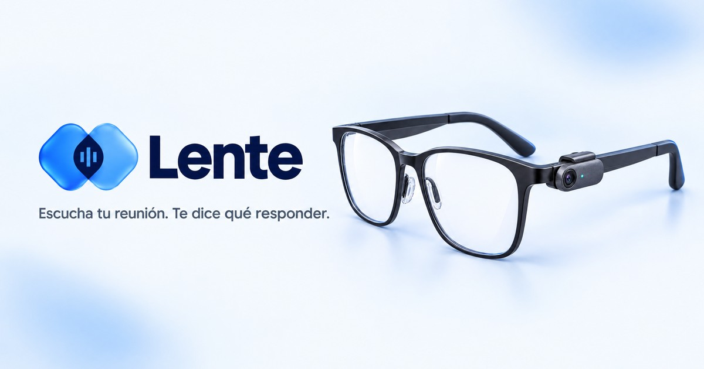
</p>

<h1 align="center">Lente</h1>

<p align="center">
  <b>It sees, listens and remembers with you.</b><br>
  A small clip for any pair of glasses, Meta's models and your phone: it reads a card aloud for someone who no longer sees well,<br>
  gives you the line to say when a meeting question is for you, and remembers what matters, with its source.
</p>

<p align="center">
  <a href="https://rulocode.github.io/lente/"><b>Website</b></a> ·
  <a href="https://drew-lizcano--lente-hub-hub.us-east.modal.run/app"><b>Try it: Sign in with Google</b></a> ·
  <a href="https://github.com/ruloCode/lente/releases/latest/download/lente.apk"><b>Android app</b></a> ·
  <a href="#run-it-locally"><b>Run it locally: <code>pnpm demo</code>, no keys</b></a>
</p>
<!-- TODO(orch) 18:30: add " · Video" (a link) to the line above once the owner gives the link. -->

<p align="center">
  
  
  
  
  
  
  
</p>

> **Meta Global AI Developer Hackathon · Indie track · Build for Your World.** Built solo in ten days in Bogotá, from 2026-10-26 ([build log](docs/build-log.md)).

## The problem

**Think of someone you love who no longer sees well.** The card from a grandchild, the medicine label, the letter from the bank: it is all right in front of them, and none of it reaches them unless someone reads it. AI glasses for blind people exist, but they are expensive and mean buying new glasses. In Colombia alone, the 2018 census counted **1,948,332 people with difficulty seeing** ([INCI, citing DANE](https://www.inci.gov.co/sites/default/files/2021-11/OAJ-102-FM-064%20v6%20INVITACION%20PUBLICA.doc)).

**And at work, the meeting moves faster than your second language.** *«Rulo, can we ship the beta on Friday?»* You know the answer, but while you build the sentence in English someone else answers, and the decision is made without you.

**You don't need new glasses.** A camera, a microphone and your phone are enough when Meta's models do the seeing, the listening and the remembering. The clip is a Seeed XIAO ESP32-S3 Sense (US$ 13.90) with a small battery, in a case printed for any glasses. No clip? The phone does its job.

## What Lente does

<table>
  <tr>
    <td width="25%">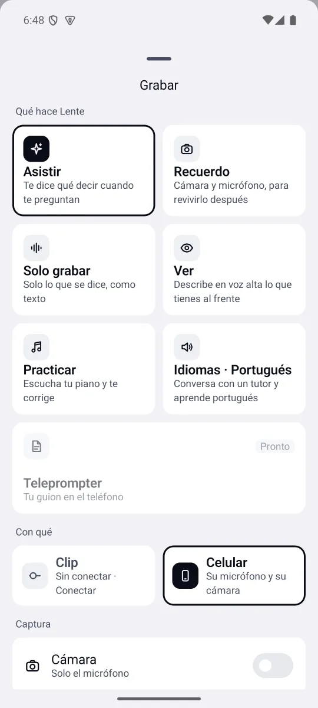</td>
    <td width="25%">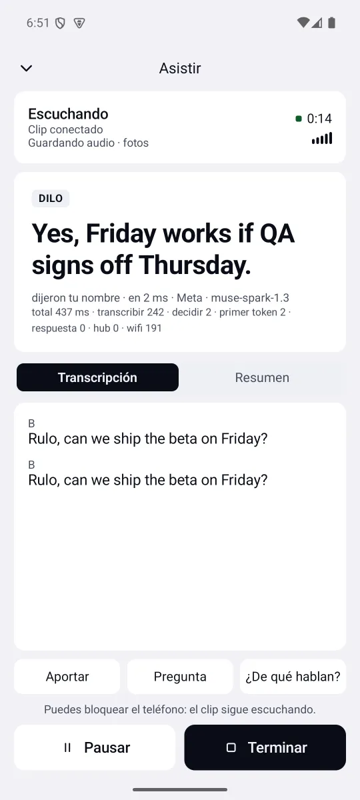</td>
    <td width="25%">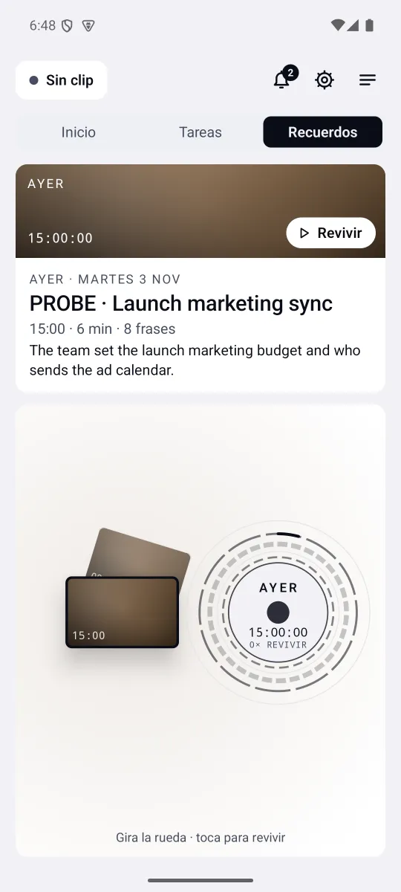</td>
    <td width="25%">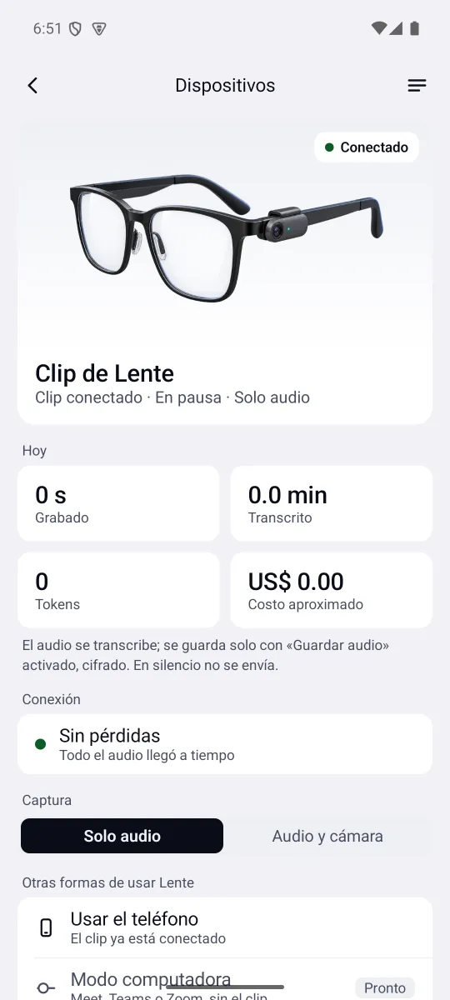</td>
  </tr>
  <tr>
    <td><sub><b>Choose how it helps:</b> Asistir, Recuerdo, Ver, Solo grabar, Practicar or a language tutor, with the clip or the phone.</sub></td>
    <td><sub><b>Asistir:</b> the question was for you, so the Dilo card shows the line to say, with every stage timed.</sub></td>
    <td><sub><b>Recuerdos:</b> the moments of your day; turn the wheel, tap one, relive it.</sub></td>
    <td><sub><b>The clip:</b> connected, what it recorded today and what it cost.</sub></td>
  </tr>
</table>
<p align="center"><sub>Real screens of the Android app (debug build on an emulator, local hub with synthetic data and the stubbed Meta API, so no real person appears and timings read a few ms; real timings in <a href="docs/benchmarks.md">docs/benchmarks.md</a>).</sub></p>

- **Ver**, for someone who no longer sees well: a warm Colombian voice learns your name and says what is in front of you, one sentence at a time; reads a paper aloud; answers «¿qué tengo en la mano?» and «¿dónde estoy?». When nothing changes it stays quiet. It describes and never guides, and never says who someone is. Works with TalkBack.
- **Asistir**, at work: Lente knows who is speaking, and when a question is for you it shows the line to say on your phone, the **Dilo** card, with its meaning in Spanish, **3.0 s** after the question ends (p50).
- **Recuerdos**: the moments of your day; turn the wheel, tap one, relive it.
- **Your memory and your agents**: notes, decisions and tasks, sealed per account. Ask by text or voice and it answers **with its source**, or says «No lo encuentro». When there is work, Claude Code or Codex do it on your computer, only after you approve it on your phone.

## How it was built, by hand

One person in Bogotá, in ten days: the clip and its firmware, the printed case, the hub, the Android app and the web app. Filmed on a pocket camera as it happened.

<table>
  <tr>
    <td width="25%">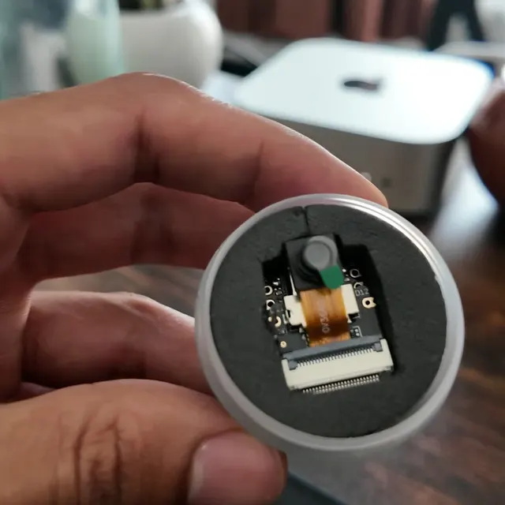</td>
    <td width="25%">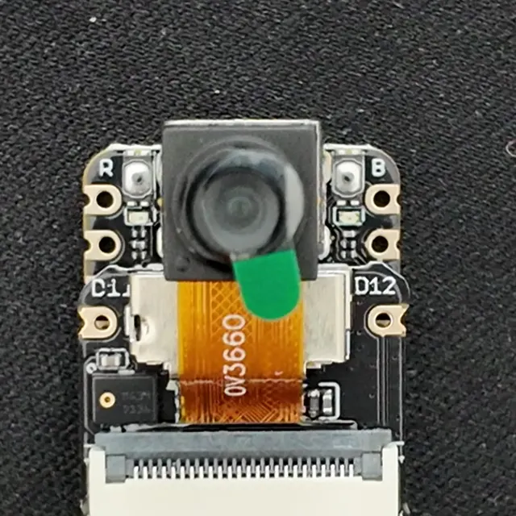</td>
    <td width="25%">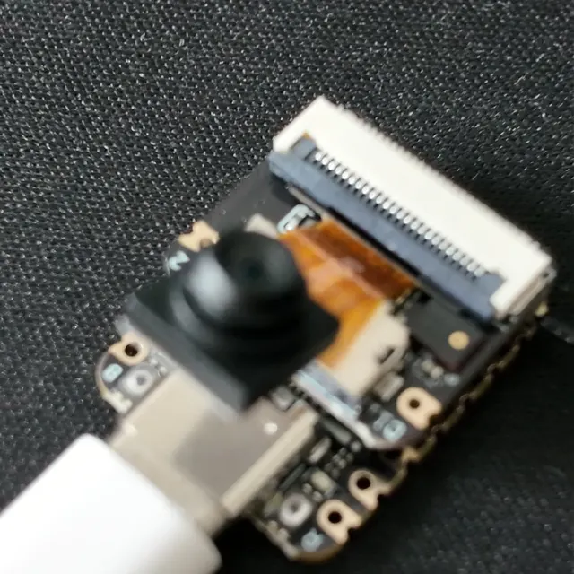</td>
    <td width="25%">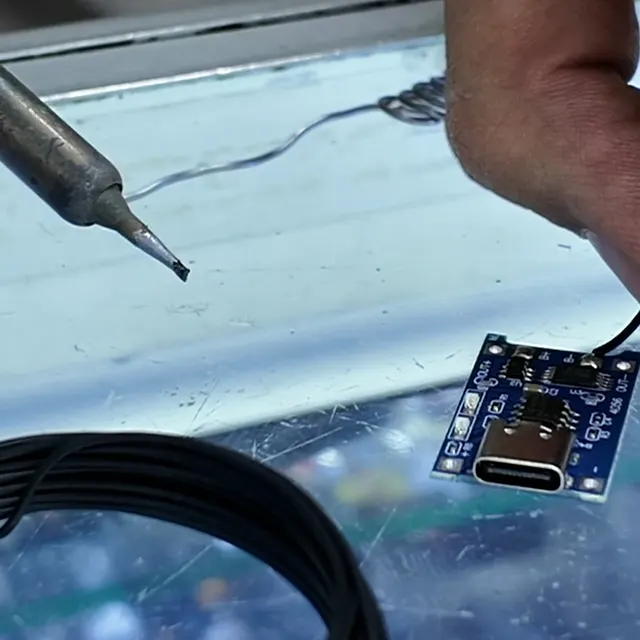</td>
  </tr>
  <tr>
    <td><sub><b>Oct 27.</b> The Seeed XIAO ESP32-S3 Sense arrives: camera, microphone and Wi-Fi in 21 × 17.8 mm.</sub></td>
    <td><sub><b>Oct 27.</b> The OV3660 camera on its flex cable, before anything is soldered.</sub></td>
    <td><sub><b>Oct 27.</b> First power-on over USB-C.</sub></td>
    <td><sub><b>Oct 29.</b> At an electronics shop: soldering the 1S USB-C charger.</sub></td>
  </tr>
  <tr>
    <td>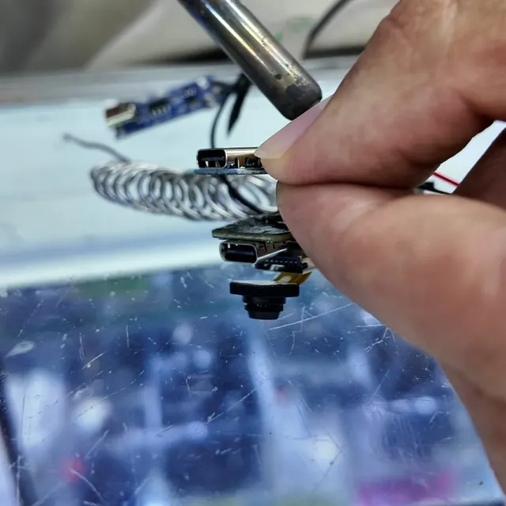</td>
    <td>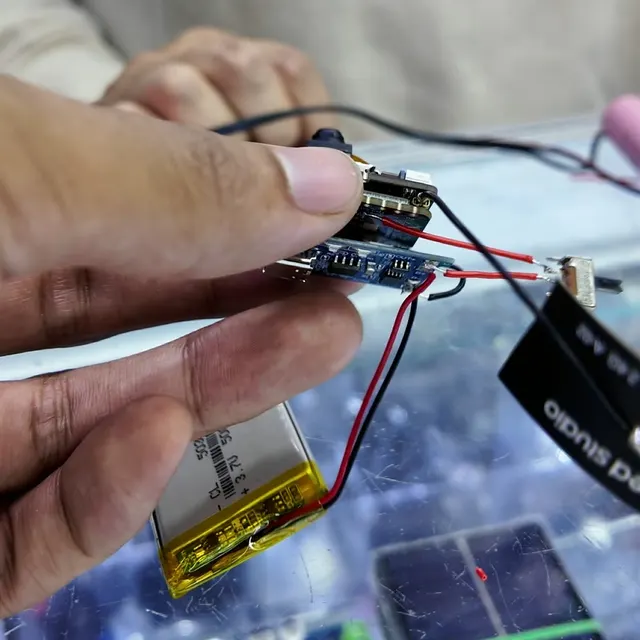</td>
    <td>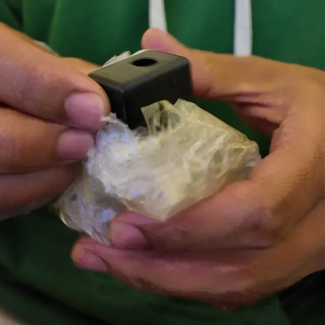</td>
    <td>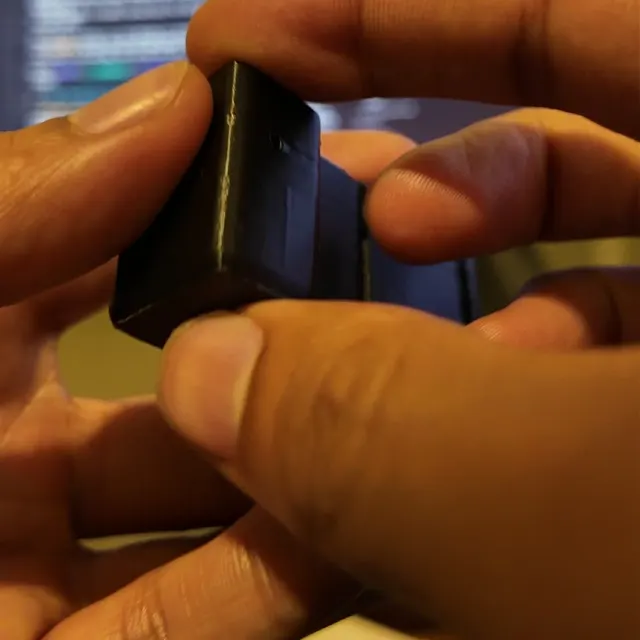</td>
  </tr>
  <tr>
    <td><sub><b>Oct 29.</b> Battery, switch and charger wired to the board.</sub></td>
    <td><sub><b>Oct 29.</b> The first working bench rig: it runs on its own battery.</sub></td>
    <td><sub><b>Oct 29, night.</b> The printed case, modelled in code around the real parts (<a href="hardware/clip-v3/clip.py"><code>clip-v3/clip.py</code></a>).</sub></td>
    <td><sub><b>Oct 29, night.</b> Everything inside: the clip that is in the video.</sub></td>
  </tr>
</table>


Print it yourself: [base](hardware/clip-v3/out/clip-base.stl) and [lid](hardware/clip-v3/out/clip-lid.stl) STL files, [parts and wiring](hardware/README.md), [firmware](firmware/lente-clip).

## How it works

**Muse Voice Transcribe** hears and tells speakers apart, **Muse Spark 1.3** sees, talks and remembers, and **Muse Spark Open** runs the fast lane. Every number is measured by a script ([docs/benchmarks.md](docs/benchmarks.md)); the details are in the [technical overview](docs/technical.md).

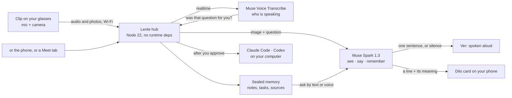

<table>
  <tr>
    <td align="center" width="25%"><h3>3.0 s</h3><sub>question ends → Dilo card on the phone (p50)</sub></td>
    <td align="center" width="25%"><h3>3.08 s</h3><sub>Ver: time to the first token of a description (p50, one-sentence prompt)</sub></td>
    <td align="center" width="25%"><h3>90 of 105</h3><sub>memory answers right, with the right source; 25 of 25 traps refused</sub></td>
    <td align="center" width="25%"><h3>863</h3><sub>unit tests, plus an end-to-end smoke test on every push</sub></td>
  </tr>
</table>


## Run it locally

No keys and no hardware: a local hub with a synthetic sample and the stubbed Meta API. With `MODEL_API_KEY` in `.env` it uses Meta's models.

```bash
git clone https://github.com/ruloCode/lente.git && cd lente
pnpm install
pnpm demo        # open http://localhost:8080/app
```

Needs Node 22.18+ and pnpm. What to try, the checks, the Android app, the clip and agents: [docs/run-locally.md](docs/run-locally.md). Or skip the install: [sign in with Google](https://drew-lizcano--lente-hub-hub.us-east.modal.run/app) or install the [Android app](https://github.com/ruloCode/lente/releases/latest/download/lente.apk).

## Everything else

| | |
|---|---|
| **Try it** | [Website (Español)](https://rulocode.github.io/lente/) · [Website (English)](https://rulocode.github.io/lente/en/) · [Web app, Sign in with Google](https://drew-lizcano--lente-hub-hub.us-east.modal.run/app) · [Android APK](https://github.com/ruloCode/lente/releases/latest/download/lente.apk) ([release notes](https://github.com/ruloCode/lente/releases/tag/v0.2.0-hackathon)) · [Run it locally](docs/run-locally.md) |
| **The hardware** | [Parts, prices in Bogotá and wiring](hardware/README.md) · print files: [case base](hardware/clip-v3/out/clip-base.stl), [lid](hardware/clip-v3/out/clip-lid.stl), [HUD arm](hardware/clip-v3/out/hud-arm.stl), [3D assembly](hardware/clip-v3/out/assembly.glb) · [parametric model (`clip.py`)](hardware/clip-v3/clip.py) and [3D viewer](hardware/clip-v3/viewer.html) · [camera board research](docs/kb/camera-boards.md) · [firmware](firmware/lente-clip) · [clip ↔ hub protocol](docs/PROTOCOL.md) |
| **How it works** | [Architecture](docs/architecture.md) · [Hub API](docs/kb/hub-api.md) · [Meta Model API as used](docs/kb/meta-api.md) · [Agents and MCP](docs/kb/agents.md) · [Decisions and the alternatives we rejected](docs/kb/decisions.md) |
| **Proof** | [Every benchmark and the script behind it](docs/benchmarks.md) · [863 unit tests](test) · [specs of what Lente does](openspec/specs) and [what comes next](openspec/changes) · [day-by-day build log](docs/build-log.md) · [CI](https://github.com/ruloCode/lente/actions) |
| **Privacy** | [Terms](https://drew-lizcano--lente-hub-hub.us-east.modal.run/terminos) · [Privacy](https://drew-lizcano--lente-hub-hub.us-east.modal.run/privacidad) · [how memory is sealed](docs/technical.md#measured) |


## License

MIT
