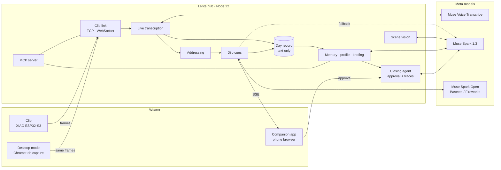

# Lente architecture

Lente is an ambient meeting copilot for people who work in their second language. A clip on any pair of glasses hears and sees the meeting; a hub uses Meta's models to notice when the wearer is being asked something and shows one line to say (the **Dilo** card); after the meeting, a verifiable agent turns what was agreed into done work, with the wearer's approval.

This document is the plan before code: the applications, the stack, the interfaces, how it runs, how data is handled, how quality is kept, and the order of work. Behavior is specified in [`openspec/specs/`](../openspec/specs) (what exists) and [`openspec/changes/`](../openspec/changes) (what comes next).

## 1. Applications

One hub, several ways in. Every source of audio and pictures speaks the same clip protocol, so the hub has one code path.

| Application | Job | Runs on | Stack | Status |
|---|---|---|---|---|
| **Clip firmware** | Hear, see, signal (LED, vibration) | Seeed XIAO ESP32-S3 Sense on the glasses | C++ on Arduino-ESP32 3.3.x, `esp32-camera`, `ESP_I2S` (PDM) | Pilot running (`firmware/lente-clip`) |
| **Hub** | Transcription, cues, vision, memory, agents, MCP | Laptop on the LAN today, Modal later | Node 22.18+, TypeScript run natively, zero runtime deps (`node:http`, `node:net`, `fetch`, `WebSocket`) | Pilot running (`src/pilot.ts`) |
| **Companion app** | Read the Dilo card, see the camera, control modes, approve actions | The wearer's phone | One HTML page served by the hub, SSE down, POST up, installable (manifest) | Pilot running (`src/pilot-page.ts`) |
| **Clip emulator** | Run Lente with no hardware (judges, CI, demo fallback) | Any computer | Node script speaking the clip protocol | Planned (`harden-clip-protocol`) |
| **Desktop mode** | Use Lente on Meet/Teams/Zoom without the clip | Chrome on a computer | Browser page: tab capture → 16 kHz PCM → clip protocol over WebSocket | Planned (`add-desktop-mode`) |
| **MCP server** | Glasses and memory as tools for any agent | Inside the hub | JSON-RPC over Streamable HTTP at `/mcp`, bearer key | Planned (`add-glasses-mcp`) |
| **Site** | Landing with the video, open-hardware build guide, 3D viewer | Static hosting | Static HTML, three.js viewer from `hardware/clip-v1` | Partly built (viewer, guide) |

Native mobile app (Expo/React Native with BLE provisioning and background audio) is a post-hackathon step; the web app covers the demo.

## 2. How it fits together



One question, end to end: the clip sends 80 ms audio frames → the hub paces them into Muse Voice Transcribe → a completed turn arrives with its speaker label → addressing decides it is aimed at the wearer → the fast lane writes one line → the phone shows the Dilo card and the clip buzzes. Every stage is timestamped (see `add-evals`).

## 3. Stack, layer by layer

| Layer | Choice | Why | Rejected |
|---|---|---|---|
| Device | XIAO ESP32-S3 Sense, OV3660, PDM mic | Camera, mic, PSRAM and LiPo charging on a 21 × 17.8 mm board | ESP32-S3-CAM + INMP441 (bigger, more parts) |
| Firmware | Arduino-ESP32 3.3.12, C++ | Mature camera and I2S drivers, fast iteration with arduino-cli | ESP-IDF (slower for a 7-day build), Zephyr |
| Wire protocol | Typed frames (type, length, payload), versioned hello, sequenced audio; TCP on the LAN, WebSocket in the cloud | One readable contract, two transports, testable with fixtures | Opus (codec id reserved; PCM16 at 256 kbps fits Wi-Fi), BLE streaming |
| Hub runtime | Node 22.18+, native TypeScript, zero runtime deps | Judges run it with one install; every line is visible | Bun/Deno, frameworks |
| Phone UI | Server-rendered HTML + vanilla JS, SSE + POST | No build step, works on any phone on the LAN | React app, native app (later) |
| Speech in | Muse Voice Transcribe, realtime, DIARIZATION, PCM 16 kHz | Speaker labels make "addressed to you" possible | Other STT vendors (not Meta) |
| Fast reply | Muse Spark Open on Baseten → Fireworks → Muse Spark 1.3 minimal | Lowest latency; open-weights bonus | Single provider |
| Vision, memory, agent | Muse Spark 1.3 (image input, structured output, function calling, prompt caching) | One model family, measured 1.1 s per photo | Separate vision model |
| Optional | SAM 3.1 (crop the slide), Muse Wonder (long analysis), Muse Glimmer (private mode) | Distinct jobs that judges can see | |
| Voice out | Phone speech synthesis; ElevenLabs when configured | Meta has no text-to-speech; output only, never the intelligence | |
| Storage | Append-only JSONL and JSON files in `data/` (git-ignored) | Readable, zero deps; long context + prompt caching instead of RAG | Vector DB/embeddings (generic pattern, extra dependency) |
| Agents | Own two-phase loop (plan → approve → act), tool registry, JSONL traces | Small, auditable, approval enforced in code | Agent frameworks |
| Extension | MCP server and client | Open standard; consent enforced in tool handlers | Plugin store |
| Hosting | Laptop on LAN; Modal for always-on (spike first) | Credits available; same code with config | |
| Tooling | OpenSpec (specs and changes), `node --test`, `tsc --noEmit`, arduino-cli, GitHub Actions | Spec-driven work judges can follow | |

## 4. Interfaces

- **Clip ↔ hub**: frames `H` hello (JSON), `A` audio (PCM16 mono 16 kHz, 80 ms), `J` JPEG; single-byte commands `P`, `B`, `C`/`c`, `M`/`m`. Versioned and documented in `docs/PROTOCOL.md` with `harden-clip-protocol`.
- **Hub ↔ phone**: `GET /events` (SSE: status, history, partial, turn, speaker, cue, live, summary), `POST /look`, `/live/on|off`, `/mode/camera|mic`, `/listen/on|off`, `/summary`, `/tts`.
- **Hub ↔ Meta**: `wss://api.meta.ai/v1/asr/realtime`; `POST /v1/chat/completions` (OpenAI shape, `reasoning_effort`, `image_url` parts: both verified 2026-10-28).
- **Hub ↔ agents**: MCP over Streamable HTTP at `/mcp` with a bearer key.

## 5. Data, privacy and consent

| Data | Where | Kept | Notes |
|---|---|---|---|
| Audio | Memory only, streamed to Muse Voice Transcribe | Never stored | Paused = nothing sent |
| Photos | Memory only, sent to Muse Spark | Never stored | Mic-only mode powers the camera down |
| Day record | `data/days/*.jsonl` | Until deleted | Text only |
| Memory, profile, traces | `data/meetings/`, `data/profile.json`, `data/traces/` | Until deleted | Delete one or all from the phone |
| Secrets | `.env`, `firmware/**/secrets.h` (git-ignored); platform secrets in the cloud | — | Rotated after the demo |

Consent is a product feature, not a footnote: the clip's LED and a clear listening state, pause everywhere, agents and MCP tools obey the same rules, and nothing leaves the hub without approval. Only standard (non-contributor) Meta endpoints are used; while on the free credits, content may be used for product improvement, so tests use the author's voice and public media and the demo meeting uses informed consent.

## 6. Engineering practices

Adopted from what the strongest open projects in this space do well (studied read-only, no code reused): a versioned protocol module with fixtures (MentraOS, Omi), sequence numbers and audio positions (Omi, MentraOS), an emulator for hardware-free runs (Brilliant Labs, Even Realities), protocol docs with byte tables (Brilliant Labs), and recorded decisions.

- **Specs first.** Every change starts as an OpenSpec proposal with specs, design and tasks; `openspec validate --all --strict` stays green.
- **Pure core, thin edges.** Parsing, pacing, addressing rules, routing policy, glossary merges and metrics are pure modules with unit tests; sockets, files and model calls stay at the edges.
- **Small, named units.** Functions do one thing; constants are named with units (`FRAME_MS`, `SUMMARY_EVERY_MS`); modules are named after the domain (addressing, memory), not the technology.
- **Dependency direction.** web/transport → hub services → pure domain modules; domain modules import nothing from the edges.
- **Explicit failures.** Errors carry what failed and why; degraded states are visible on the phone (no key, clip offline, transcription reconnecting).
- **Measured, not claimed.** Stage timestamps on every cue; numbers in docs come from `pnpm eval` and `scripts/`.
- **One CI workflow.** Typecheck, unit tests, firmware compile, and an emulator-driven end-to-end smoke test with the Meta API stubbed.
- **Keep the root clean.** Plans live in `openspec/`, knowledge in `docs/kb/`, decisions in `docs/kb/decisions.md`; no stray report files.

Target layout as changes land (moved gradually, never in a big-bang refactor):

```
src/protocol/   frames, hello, fixtures (pure)        src/memory/  meetings, profile, briefing
src/transport/  tcp, websocket                         src/agent/   loop, tools, traces
src/asr/        session, pacing, offsets               src/mcp/     server, client
src/cues/       addressing, routing, replies           src/web/     page, SSE, routes
scripts/        bench, eval, fake-clip                 test/fixtures/
docs/           architecture, PROTOCOL, benchmarks, kb  firmware/, hardware/, openspec/
```

## 7. Order of work (until 2026-11-04 21:00 ET)

| Day | Changes | Why this order |
|---|---|---|
| Wed 28 | `harden-clip-protocol`, `apply-dilo-identity` | The emulator unlocks evals, CI and a hardware-free demo; the identity is small |
| Thu 29 | `add-addressed-to-you`, `add-evals` (set + runner) | The core moment of the demo, measured from day one |
| Fri 30 | `add-meeting-memory`, `add-fast-reply-lane` (if Baseten approves); buy parts, print case | Memory feeds the agent; routing needs partner keys |
| Sat 31 | `add-closing-agent`; assemble the clip with motor | Agentic bonus |
| Sun 1 | `add-glasses-mcp`, `add-cloud-hub` spike | Extension surface; hosting decision |
| Mon 2 | `add-cloud-hub` or `add-desktop-mode` (whichever the spike favors), full eval run, CI green | Polish and numbers for the video |
| Tue 3 | Video, README, submission, X post | |
| Wed 4 | Buffer | |

Must: protocol, identity, addressing, evals, memory, closing agent. Should: fast lane, MCP. Could: cloud hub, desktop mode. Post-hackathon: native app with BLE, HUD, private mode with Muse Glimmer, team memory, Lente as an app on Meta Ray-Ban Display.

## 8. Related work

- [Omi / omiGlass](https://github.com/BasedHardware/omi): open-source AI wearable; omiGlass uses the same XIAO ESP32-S3, over BLE.
- [OpenGlass](https://github.com/BasedHardware/OpenGlass): the original "turn any glasses into AI glasses" clip.
- [MentraOS](https://github.com/Mentra-Community/MentraOS): smart-glasses OS with a cloud transcription service.
- [Brilliant Labs SDK](https://github.com/brilliantlabsAR/brilliant_sdk) and [Frame](https://github.com/brilliantlabsAR/frame-codebase): open AR glasses with an on-device Lua runtime.
- [Even Realities EvenDemoApp](https://github.com/even-realities/EvenDemoApp): published BLE protocol for display glasses.
- [free-cluely](https://github.com/Prat011/free-cluely) and [Recap](https://github.com/RecapAI/Recap): desktop meeting assistants and capture.

Lente differs in three ways: it is built around the moment the wearer is addressed in a second language, it works on any glasses or none (desktop mode), and its agents are verifiable and approval-gated. Nothing from these projects is copied; they are cited as prior art.
