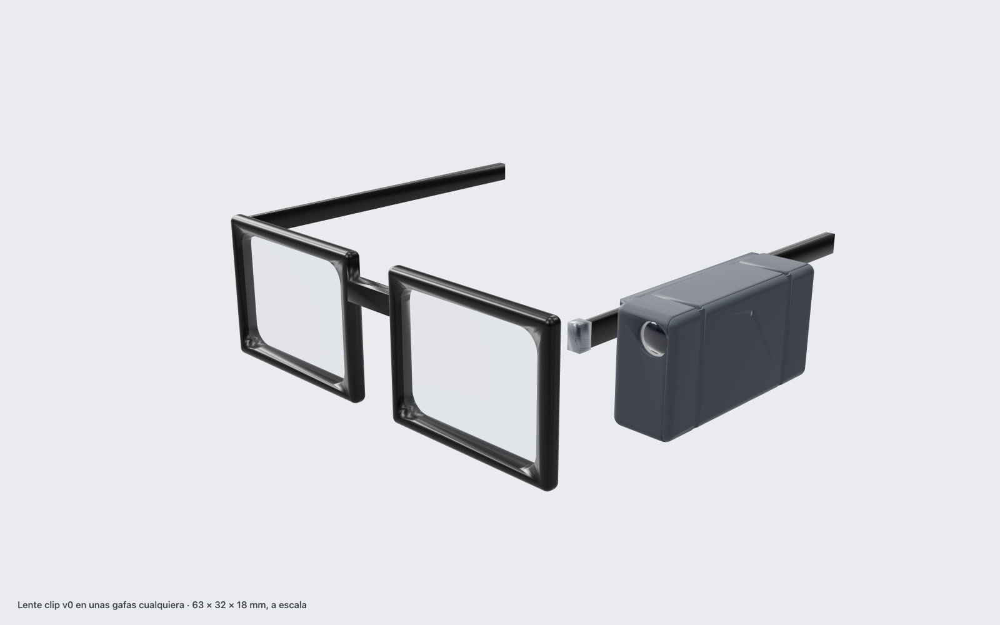
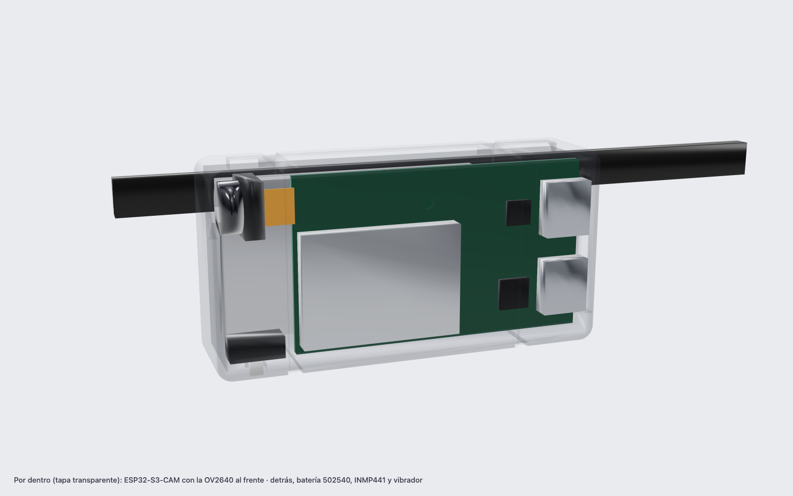
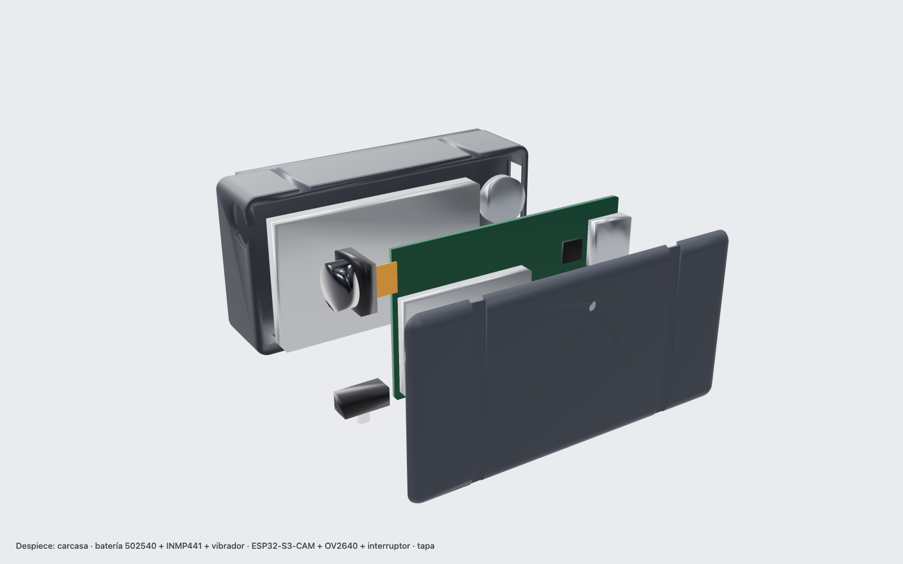

# Lente clip v0

A pod that straps to the temple of **any** pair of glasses: a forward-facing camera at eye level, a microphone, a vibration motor for silent cues, and a battery. Built from parts you can buy in Bogotá this week, modelled at their real dimensions.



| | |
|---|---|
| Outside | **63.2 × 17.7 × 32.2 mm** (length × thickness × height) |
| Shell | 10.3 cm³, ~13 g in PLA |
| Total weight (est.) | ~38 g: board 9, camera 2, battery 10, mic 1, motor 1, switch 1, shell 13 |
| Battery life (est.) | 1.5–2 h streaming at 550 mAh (ESP32-S3 + camera + Wi-Fi ≈ 250–350 mA). To be measured |
| Clearance check | `clip.py` verifies no part collides with another or with the shell |




## Parts

| Part | Size used in the model (mm) | Where (Colombia) | ~COP |
|---|---|---|---|
| ESP32-S3-CAM N16R8 + OV2640, dual USB-C | 48 × 28, 6.5 thick without pin headers | [Zamux (Bogotá)](https://www.zamux.co/en/tarjeta-de-desarrollo-esp32s3-cam-wroom-n16r8-camara-ov2640) · [Didácticas 120°](https://www.didacticaselectronicas.com/shop/esp32-s3-cam-n16r8-120-modulo-wifi-bluetooth-esp-32-s3-n16r8-con-camara-ov2640-120-usb-tipo-c-45054) | 59k–107k |
| OV2640 module (comes with the board) | 8.5 × 8.5, 6 deep with lens | — | — |
| INMP441 I2S microphone | 14 × 14 × 3 | [MercadoLibre](https://listado.mercadolibre.com.co/inmp441) | 15k–25k |
| LiPo 502540, 550 mAh, JST-SH | 40 × 25 × 5 (+3 protection board) | [Didácticas](https://www.didacticaselectronicas.com/shop/502540-3-7-550ma-bateria-litio-polimero-3-7v-550mah-con-conector-jst-sh-1-0mm-21418) | 13.5k |
| Coin vibration motor | Ø10 × 2.7 | [Didácticas](https://www.didacticaselectronicas.com/shop/m-v-4-motor-vibrador-redondo-1-3-3-6v-0-65a-3044) | 1.8k |
| Slide switch SS12D00 | 8.6 × 4 × 3.5 | Any electronics store | 1k |
| NPN transistor (S8050 / 2N2222) + 1N4148 diode + 1 kΩ | for the motor | Any electronics store | 1k |
| USB-C LiPo charger (1S), **outside the pod** | — | [Didácticas](https://www.didacticaselectronicas.com/shop/car-lipo-usb04-cargador-usb-tipo-c-para-bateria-litio-3-7v-1s-43710) | 2.5k |
| 2 silicone bands or small zip ties | 2.4 mm wide grooves | — | — |
| 30 AWG silicone wire, heat shrink | | | |

**Measure every part when it arrives and update the numbers at the top of `clip/clip.py`.** Listings disagree on board sizes (48 × 28 at Didácticas, 51 × 29 and 67 × 29 from other vendors); the model is parametric for that reason.

## Layout

Two layers, seen from above the temple:

- **Outer layer** (against the lid): the ESP32-S3-CAM board, USB-C ports at the back. The camera is folded on its flex cable to face forward through the front wall, at the height of the temple, so it sees what you see. The switch sits under the camera, its lever out through the bottom.
- **Head side** (against the temple): the battery, the INMP441 at the back-bottom with its sound port through the head-side wall, and the motor at the back-top pressing on the temple, so you feel the buzz.
- **Mount:** two ribs on the head-side face form a 7 × 3 mm channel the temple sits in; two bands around pod and temple, in grooves, hold it. Works on any temple up to 7 mm tall.

## Wiring

Pins to verify against your board's pinout: the camera uses most low GPIOs, and on N16R8 modules GPIO 35–37 belong to the octal PSRAM. Avoid 19/20 (USB).

| From | To |
|---|---|
| INMP441 SCK / WS / SD | GPIO 14 / 21 / 47 |
| INMP441 L/R | GND (left channel) |
| INMP441 VDD / GND | 3V3 / GND |
| Motor | 3V3 → motor → transistor collector; emitter → GND; base ← GPIO 1 through 1 kΩ; 1N4148 across the motor |
| Battery + | switch → board **5V/VIN**. See power below |

### Power: check this first

The LiPo gives 3.0–4.2 V. Read the regulator chip next to the USB ports:

- **ME6211, AP2112, RT9013 or similar low-dropout:** battery to 5V/VIN works down to ~3.4 V.
- **AMS1117:** it needs ~4.4 V in. Add a 3.3 V low-dropout regulator (HT7333 / MCP1700) feeding the 3V3 pin, or a mini 5 V boost converter to VIN.

v0 charges the battery outside the pod: unplug its JST and plug it into the charger. v1 moves the charger inside.

## Printing

- `clip/out/clip-base.stl`: stand it on its back face (the one with the USB-C window). No supports.
- `clip/out/clip-lid.stl`: outer face on the bed, lip up.
- PLA or PETG, 0.2 mm layers, 3 perimeters. Clearance 0.2 mm per side is set in `FIT`.
- No printer? A print-on-demand service, or a foam-board mock-up with the same dimensions to test fit and camera angle the same day.

## Build plan (7 days)

| Day | Hardware | Software (in parallel, webcam stands in for the glasses) |
|---|---|---|
| Tue Oct 27 | Buy parts (Zamux pickup, Didácticas and MercadoLibre delivery) | Firmware base on the spare ESP32-S3: Wi-Fi + WebSocket to the server |
| Wed Oct 28 | Board arrives: camera JPEG capture and streaming; read the regulator | Server pipeline: frames → Muse Spark, audio → Muse Voice Transcribe |
| Thu Oct 29 | INMP441 on I2S → PCM16 16 kHz to the server; print the shell | First end-to-end with the webcam |
| Fri Oct 30 | Battery, switch, motor and transistor wired; first wearable test | Cue logic and the haptic channel |
| Sat Oct 31 | Assemble in the shell, fit on glasses, measure battery life | Use-case flow end to end |
| Sun Nov 1 | Field test with the real use case | Fixes from the field test |
| Mon Nov 2 | Polish, film b-roll of the clip being built and worn | Latency numbers for the video |

## Regenerate

```bash
uv venv ~/.cache/lente-cad-venv && VIRTUAL_ENV=~/.cache/lente-cad-venv uv pip install manifold3d trimesh numpy
~/.cache/lente-cad-venv/bin/python hardware/clip/clip.py     # STL, GLB, dimensions.json + clearance check
python hardware/clip/render.py                               # PNG renders (needs Playwright + Chrome)
```

## v1 (after the hackathon)

Seeed XIAO ESP32-S3 Sense (21 × 17.5 mm, camera and mic on board) and a 250 mAh cell bring the pod to about 40 × 12 × 22 mm and ~20 g, the size of the concept renders.
